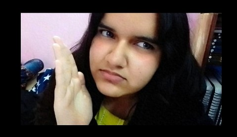

<!DOCTYPE html>
<html>
<head>
<meta name="viewport" content="width=device-width, initial-scale=1">
<title>For Shazzy ♡</title>

</head>
<body>

  <h1>SHazzyyyy!! 💌</h1>
  
I have something to tell you...

  <h3>Open it?</h3>
  <button onclick="next('question')">OPEN IT ♡</button>

  <h1>Do you love me? 🥺</h1>
  <button onclick="next('final')">YESSS ♡</button>
  <button class="no" onclick="next('sad')">NO</button>

  <h1>Oh. 🥲</h1>
  
  
That's actually so mean...

  
Are you REALLY sure?

  <button onclick="next('final')">YES, OF COURSE ♡</button>
  <button class="no" id="noBtn">STILL NO</button>

  
  <h1>I MISH YOU, SHAZZY!! 💗</h1>
  
SOOO MUCHHH.

  
It's boring without you here.

  <h2>Come back soon, lallu. ♡</h2>
  <h1>MWAHHH 💋</h1>

</body>
</html>

